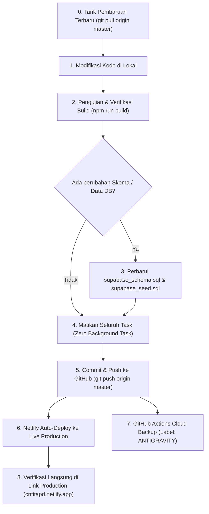

# Standar Kerja & Protokol Operasional (SOP) CNT IT APD Web

Dokumen ini merupakan panduan standar operasional baku bagi pengembang dan agen AI (Antigravity) dalam mengelola, mengembangkan, dan memelihara ekosistem aplikasi CNT IT APD.

---

## 1. Arsitektur Konektivitas & Aliran Data

| Platform / Komponen | Peran & Sumber | Endpoint / URL | Status Terhubung |
| :--- | :--- | :--- | :--- |
| **Local Machine** | Verifikasi build lokal (`npm run build`) | Workspace Lokal | Aktif (Offline/Lokal, Zero Background Task) |
| **GitHub Cloud** | *Single Source of Truth* repositori publik & runner CI/CD | `https://github.com/gahasapurba/cntitapd-web.git` | Terhubung langsung (Remote: `origin`) |
| **Netlify (Production)** | Production Web Hosting & Edge Functions (Auto-deploy dari GitHub) | `https://cntitapd.netlify.app` | **Single Source of Truth untuk Peninjauan UI & Fitur Live** |
| **Supabase Cloud** | Backend Database (PostgreSQL 16) & Media Storage Bucket (`cnt-media`) | `https://xarcxbfgeoetyhpqsick.supabase.co` | Terhubung aktif (REST & Management API) |

---

## 2. Standar Siklus Pengembangan (Development Lifecycle) & Sinkronisasi Multi-Device

Proyek ini dikembangkan secara fleksibel lintas perangkat (misal: laptop kerja dan laptop pribadi) dengan **GitHub (`origin/master`) sebagai Single Source of Truth**. Oleh karena itu, siklus pengembangan wajib mengikuti alur sinkronisasi berikut:

> [!IMPORTANT]
> **Aturan Wajib Multi-Device (Selalu Pull Sebelum Mulai)**:
> - **Sebelum memulai pekerjaan/sesi baru**: Agen dan pengembang **WAJIB selalu mengeksekusi `git pull origin master`** terlebih dahulu. Hal ini menjamin pekerjaan selalu berbasis commit terbaru yang mungkin baru saja di-push dari perangkat/laptop lain.
> - **Kondisi Branch Bersih**: Selalu pastikan branch lokal `master` telah up-to-date dengan `origin/master` sebelum melakukan perubahan kode apa pun.

---

## 3. Kewajiban Pembaruan 3 Pilar Setiap Perubahan (Update Schema, Seed, dan Backup di GitHub)

Setiap kali melakukan perubahan, penambahan fitur, perbaikan bug, pembaruan skema, atau modifikasi data pada proyek CNT IT APD, Antigravity **WAJIB selalu memperbarui 3 hal berikut**:

1. **Perbarui `supabase_schema.sql` (Master Blueprint DDL)**:
   - Wajib selalu diperbarui dan diselaraskan setiap ada penambahan tabel baru, penambahan kolom baru (misal `is_public`), perubahan tipe data, constraint, relasi foreign key, indeks, maupun aturan RLS & Storage policies.
   - Harus selalu idempotent (`CREATE TABLE IF NOT EXISTS`, `ALTER TABLE ... ADD COLUMN IF NOT EXISTS`) sehingga aman dijalankan kapan saja untuk recovery.

2. **Perbarui `supabase_seed.sql` (Master Data Seed)**:
   - Wajib disinkronkan dengan data master terbaru (`tenures`, `tenure_roles`, `departments`, `divisions`, `members`, `brand_assets`, `faqs`, `forms`).
   - Seluruh baris data menggunakan klausa `ON CONFLICT DO NOTHING` agar idempotent saat proses restore.

3. **Backup Otomatis di GitHub (Cloud Backup, Bebas Beban Disk Lokal)**:
   - **DILARANG menyimpan berkas backup (.zip / .json) di penyimpanan komputer lokal** agar kapasitas disk lokal pengguna tetap bersih dan tidak berkurang.
   - File backup dieksekusi dan disimpan secara aman di **GitHub Actions Cloud Artifacts**.
   - **Backup dienkripsi** (AES-256 + PBKDF2, `openssl` bawaan macOS) karena repo publik: artifact Actions bisa diunduh akun GitHub mana pun. Passphrase ada di secret `BACKUP_PASSPHRASE` (salinan di `.env` lokal, tidak ikut Git). Tanpa secret, workflow sengaja gagal. Membuka: `BACKUP_PASSPHRASE=... openssl enc -d -aes-256-cbc -pbkdf2 -iter 600000 -md sha256 -pass env:BACKUP_PASSPHRASE -in supabase-backup-*.tar.gz.enc | tar -xz`.
   - Setiap kali `supabase_schema.sql` atau `supabase_seed.sql` di-commit & di-push ke GitHub, GitHub Actions otomatis memicu full backup database + storage fisik.
   - Dilengkapi sistem penandaan otomatis (*labeling artifact*):
     - **`supabase-backup-ANTIGRAVITY-...`**: Dijalankan otomatis oleh Antigravity AI pasca perubahan skema/seed.
     - **`supabase-backup-SYSTEM-...`**: Dijalankan otomatis oleh sistem terjadwal setiap hari pukul 02:00 WIB.
     - **`supabase-backup-MANUAL-...`**: Dijalankan manual oleh pengguna melalui menu Actions di GitHub.

---

## 4. Kebijakan Zero Background Task (Wajib Mati Semua Setelah Digunakan)

Antigravity **WAJIB memastikan seluruh background task MATI TOTAL setelah digunakan**:
- **Tidak Boleh Ada Task Menggantung**: Tidak ada dev server lokal (`npm run dev`), compiler, watcher, ataupun daemon process yang dibiarkan tetap berjalan di background setelah respon selesai.
- **Segera Dihentikan (*Killed*)**: Segala task pengujian sementara, print-to-pdf, build check, atau CLI process **wajib segera di-kill** begitu tugasnya selesai.
- **Beban Memori & CPU Bersih**: Kondisi akhir di setiap akhir giliran harus selalu menunjukkan status background task aktif: **0 (Nol)**.

---

## 5. Standar Verifikasi Langsung di Link Production (Live Web Review)

Untuk melihat dan memverifikasi setiap hasil perubahan kode, fitur, tampilan visual, maupun tata letak:
- **Verifikasi Langsung di Link Prod**: Peninjauan hasil dilakukan langsung pada URL live production:
  👉 **[https://cntitapd.netlify.app](https://cntitapd.netlify.app)**
- **Auto-Deployment Netlify**: Setiap commit yang di-push ke branch `master` di GitHub otomatis memicu build & publish pada Netlify dalam ~1-2 menit.
- **Pengecekan Responsivitas**: Pengguna dan agen meninjau tampilan desktop maupun tampilan mobile langsung melalui browser pada link production tersebut. Tidak memerlukan dev server lokal atau pembuatan screenshot lokal secara berkala.

---

## 6. Ambang Batas Kapasitas & Early Warning (Supabase Free Tier)

| Metrik | Batas Kuota Free | Warning Threshold | Critical Threshold | Tindakan Pencegahan |
| :--- | :---: | :---: | :---: | :--- |
| **Database** | 500 MB | 350 MB | 450 MB | Arsip log aspirasi/RSVP lawas |
| **Storage Bucket** | 1.000 MB (1 GB) | 400 MB | 800 MB | Kompresi WebP gambar gallery/member |

Script backup di GitHub Actions akan otomatis mengeluarkan notifikasi `::warning::` atau `::error::` di Step Summary apabila ambang batas ini terlampaui.

---

## 7. Standar Pelaporan Wajib Agen AI (Mandatory Reporting Protocol)

Setiap kali Antigravity menyelesaikan perubahan, pembaruan fitur, skema/seed, atau permintaan pengguna, Antigravity **WAJIB** menyertakan 5 bagian laporan berikut secara lengkap:

1. **Status Konektivitas ("Sekarang Kamu Terhubung ke Mana")**:
   - Memetakan koneksi aktif (GitHub Cloud `origin`, Netlify Production, dan Supabase Cloud).
2. **Tabel Rangkuman Status 4 Pilar Ekosistem**:
   - Local Machine, GitHub Cloud, Netlify Production, dan Supabase Cloud.
3. **Status 3 Pilar Sinkronisasi (Schema, Seed, dan Backup Cloud)**:
   - `supabase_schema.sql`, `supabase_seed.sql`, dan status GitHub Actions Cloud Backup.
4. **Tautan Verifikasi Live Production**:
   - Tautan langsung ke `https://cntitapd.netlify.app` beserta ringkasan apa saja yang dapat langsung dicek di halaman produksi.
5. **Audit Status Background Task (Zero Running Tasks)**:
   - Konfirmasi bahwa seluruh background task telah **mati total (0 task aktif)** dan beban sistem telah bersih.
