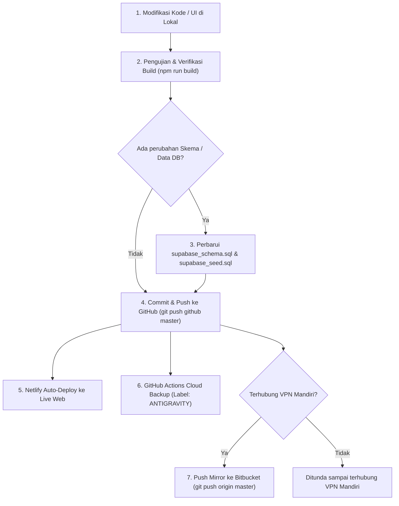

# Standar Kerja & Protokol Operasional (SOP) CNT IT APD Web

Dokumen ini merupakan panduan standar operasional baku bagi pengembang dan agen AI (Antigravity) dalam mengelola, mengembangkan, dan memelihara ekosistem aplikasi CNT IT APD.

---

## 1. Arsitektur Konektivitas & Aliran Data

| Platform / Komponen | Peran & Sumber | Endpoint / URL | Status Terhubung |
| :--- | :--- | :--- | :--- |
| **Local Machine** | Lingkungan pengembangan & testing lokal | `http://localhost:5173` | Aktif (Vite Dev Server) |
| **GitHub Cloud** | *Single Source of Truth* repositori publik & runner CI/CD | `https://github.com/gahasapurba/cntitapd-web.git` | Terhubung langsung (Remote: `github`) |
| **Netlify** | Production Web Hosting & Edge Functions (Auto-deploy dari GitHub) | `https://cntitapd.netlify.app` | Otomatis sinkron dari GitHub `master` |
| **Supabase Cloud** | Backend Database (PostgreSQL 16) & Media Storage Bucket (`cnt-media`) | `https://xarcxbfgeoetyhpqsick.supabase.co` | Terhubung aktif (REST & Management API) |
| **Bitbucket Mandiri** | Repositori internal korporat Bank Mandiri | `https://apdgit.bankmandiri.co.id/scm/~2402814297/cnt-it-apd.git` | Remote: `origin` (Memerlukan VPN Mandiri) |

---

## 2. Standar Siklus Pengembangan (Development Lifecycle)

Setiap penambahan fitur, perbaikan bug, atau pembaruan konfigurasi wajib melalui tahapan berikut:

---

## 3. Kewajiban Pembaruan 3 Pilar Setiap Perubahan (Update Schema, Seed, dan Backup di GitHub)

Setiap kali melakukan perubahan, penambahan fitur, perbaikan bug, pembaruan skema, atau modifikasi data pada proyek CNT IT APD, Antigravity **WAJIB selalu memperbarui 3 hal berikut**:

1. **Perbarui `supabase_schema.sql` (Master Blueprint DDL)**:
   - Wajib selalu diperbarui dan diselaraskan setiap ada penambahan tabel baru, penambahan kolom baru (misal `is_public`), perubahan tipe data, constraint, relasi foreign key, indeks, maupun aturan RLS & Storage policies.
   - Harus selalu idempotent (`CREATE TABLE IF NOT EXISTS`, `ALTER TABLE ... ADD COLUMN IF NOT EXISTS`) sehingga aman dijalankan kapan saja untuk recovery.

2. **Perbarui `supabase_seed.sql` (Master Data Seed)**:
   - Wajib disinkronkan dengan data master terbaru (`tenures`, `tenure_roles`, `departments`, `divisions`, `members`, `brand_assets`, `faqs`, `forms`).
   - Seluruh baris data menggunakan klausa `ON CONFLICT DO NOTHING` agar idempotent saat proses restore.

3. **Backup Otomatis di GitHub (Cloud Backup, Bebas Beban Disk Lokal)**:
   - **DILARANG menyimpan berkas backup (.zip / .json) di penyimpanan komputer lokal** agar kapasitas disk lokal pengguna tetap bersih dan tidak berkurang.
   - File backup dieksekusi dan disimpan secara aman di **GitHub Actions Cloud Artifacts**.
   - Setiap kali `supabase_schema.sql` atau `supabase_seed.sql` di-commit & di-push ke GitHub, GitHub Actions otomatis memicu full backup database + storage fisik.
   - Dilengkapi sistem penandaan otomatis (*labeling artifact*):
     - **`supabase-backup-ANTIGRAVITY-...`**: Dijalankan otomatis oleh Antigravity AI pasca perubahan skema/seed.
     - **`supabase-backup-SYSTEM-...`**: Dijalankan otomatis oleh sistem terjadwal setiap hari pukul 02:00 WIB.
     - **`supabase-backup-MANUAL-...`**: Dijalankan manual oleh pengguna melalui menu Actions di GitHub.

---

## 4. Standar Pengujian Responsif Mobile (Mobile-First Responsiveness)

Setiap perubahan antarmuka pengguna (UI) **WAJIB memastikan tampilan responsif di perangkat mobile**:
- **Tidak Terpotong**: Elemen visual, badge, kalender, modal, dan tabel tidak boleh meluap (*overflow*) atau terpotong tanpa sengaja.
- **Interaksi Sentuh**: Tombol, chip, dan link memiliki ukuran sentuh yang ramah jari (*touch-friendly*).
- **Konsistensi Indikator**: Perbedaan gaya visual (seperti garis putus-putus pada event draft, badge publik/draft, dan warna divisi) harus terlihat tajam, kontras, dan konsisten di layar smartphone.
- **Scroll yang Terkendali**: Komponen grid yang memerlukan scroll horizontal (seperti kalender bulanan penuh) wajib memiliki scroll container halus dan hint panduan yang jelas.

---

## 5. Standar 4 Screenshot Matrix Verifikasi UI

Setiap kali menyelesaikan perubahan fitur visual, Antigravity **WAJIB menghasilkan dan menyajikan 4 Screenshot Matrix Verifikasi**:

| No | Format Tampilan | Device / Ukuran Viewport | Kondisi Tema |
| :---: | :--- | :--- | :---: |
| **1** | **Web Desktop Light** | Safari MacBook Air 13 inch (`1440 x 900`) | ☀️ Light Theme |
| **2** | **Web Desktop Dark** | Safari MacBook Air 13 inch (`1440 x 900`) | 🌙 Dark Theme |
| **3** | **Mobile Light** | iPhone 17 Pro Max (`440 x 956`) | ☀️ Light Theme |
| **4** | **Mobile Dark** | iPhone 17 Pro Max (`440 x 956`) | 🌙 Dark Theme |

**Ketentuan Screenshot**:
- Seluruh screenshot harus menangkap secara tepat komponen/fitur yang baru saja dimodifikasi.
- Gambar screenshot disimpan ke direktori artifacts dan ditautkan dalam format carousels/markdown gambar.

---

## 6. Audit & Pengendalian Background Task

Antigravity **WAJIB memastikan tidak ada background task yang tidak perlu berjalan**:
- Hanya proses penunjang penting yang berstatus *daemon* (misalnya: Vite Dev Server `localhost:5173`) yang diperbolehkan tetap berjalan di latar belakang.
- Task pengujian sementara, headless browser, print-to-pdf, atau proses CLI one-off **wajib segera dihentikan (*killed*) dan dibersihkan** begitu tugasnya selesai agar tidak membebani memori dan CPU pengguna.
- Setiap laporan wajib mencantumkan status kesehatan background task yang aktif.

---

## 7. Ambang Batas Kapasitas & Early Warning (Supabase Free Tier)

| Metrik | Batas Kuota Free | Warning Threshold | Critical Threshold | Tindakan Pencegahan |
| :--- | :---: | :---: | :---: | :--- |
| **Database** | 500 MB | 350 MB | 450 MB | Arsip log aspirasi/RSVP lawas |
| **Storage Bucket** | 1.000 MB (1 GB) | 400 MB | 800 MB | Kompresi WebP gambar gallery/member |

Script backup di GitHub Actions akan otomatis mengeluarkan notifikasi `::warning::` atau `::error::` di Step Summary apabila ambang batas ini terlampaui.

---

## 8. Standar Pelaporan Wajib Agen AI (Mandatory Reporting Protocol)

Setiap kali Antigravity menyelesaikan perubahan, pembaruan fitur, skema/seed, atau permintaan pengguna, Antigravity **WAJIB** menyertakan 5 bagian laporan berikut secara lengkap:

1. **Status Konektivitas ("Sekarang Kamu Terhubung ke Mana")**:
   - Memetakan koneksi aktif (Local Dev, GitHub Cloud, Netlify, Supabase, dan Bitbucket Mandiri).
2. **Tabel Rangkuman Status 5 Pilar Ekosistem**:
   - Local, Netlify, Supabase, GitHub, dan Bitbucket Mandiri.
3. **Status 3 Pilar Sinkronisasi (Schema, Seed, dan Backup Cloud)**:
   - `supabase_schema.sql`, `supabase_seed.sql`, dan status GitHub Actions Cloud Backup.
4. **4 Screenshot Matrix Verifikasi UI**:
   - Web Light (1440x900), Web Dark (1440x900), Mobile Light (440x956), Mobile Dark (440x956).
5. **Audit Status Background Task**:
   - Memastikan hanya task penting yang aktif dan tidak ada task sisa/tak perlu.
