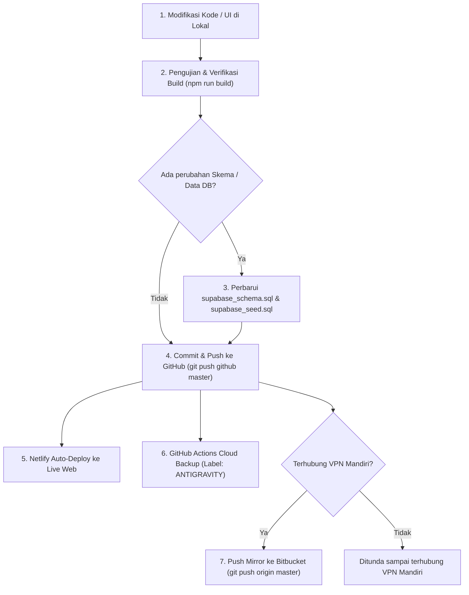

# Standar Kerja & Protokol Operasional (SOP) CNT IT APD Web

Dokumen ini merupakan panduan standar operasional baku bagi pengembang dan agen AI (Antigravity) dalam mengelola, mengembangkan, dan memelihara ekosistem aplikasi CNT IT APD.

---

## 1. Arsitektur Konektivitas & Aliran Data

| Platform / Komponen | Peran & Sumber | Endpoint / URL | Status Terhubung |
| :--- | :--- | :--- | :--- |
| **Local Machine** | Lingkungan pengembangan & testing lokal | `http://localhost:5173` | Aktif (Vite Dev Server) |
| **GitHub Cloud** | *Single Source of Truth* repositori publik & runner CI/CD | `https://github.com/gahasapurba/cntitapd-web.git` | Terhubung langsung (Remote: `github`) |
| **Netlify** | Production Web Hosting & Edge Functions (Auto-deploy dari GitHub) | `https://cntitapd.netlify.app` | Otomatis sinkron dari GitHub `master` |
| **Supabase Cloud** | Backend Database (PostgreSQL 16) & Media Storage Bucket (`cnt-media`) | `https://xarcxbfgeoetyhpqsick.supabase.co` | Terhubung aktif (REST & Management API) |
| **Bitbucket Mandiri** | Repositori internal korporat Bank Mandiri | `https://apdgit.bankmandiri.co.id/scm/~2402814297/cnt-it-apd.git` | Remote: `origin` (Memerlukan VPN Mandiri) |

---

## 2. Standar Siklus Pengembangan (Development Lifecycle)

Setiap penambahan fitur, perbaikan bug, atau pembaruan konfigurasi wajib melalui tahapan berikut:

---

## 3. Aturan Ketat Skema & Master Data (The 3 Pillars)

1. **`supabase_schema.sql` (Master Blueprint)**:
   - Wajib selalu diperbarui jika ada penambahan tabel, kolom, constraint, indeks, atau RLS policies.
   - Harus bersifat idempotent (`CREATE TABLE IF NOT EXISTS`, `ALTER TABLE ... ADD COLUMN IF NOT EXISTS`).
2. **`supabase_seed.sql` (Master Data)**:
   - Wajib mencatat data referensi terbaru (`tenures`, `roles`, `departments`, `divisions`, `members`, `brand_assets`, `faqs`, `forms`).
   - Menggunakan `ON CONFLICT DO NOTHING` agar aman dijalankan ulang.
3. **Backup Cloud Otomatis (Tanpa Beban Lokal)**:
   - **Dilarang keras menyimpan file arsip backup (.zip / .json) di penyimpanan lokal.**
   - Backup otomatis berjalan di GitHub Actions dengan artifact labeling:
     - `supabase-backup-SYSTEM-...` untuk backup terjadwal sistem jam 02:00 WIB.
     - `supabase-backup-ANTIGRAVITY-...` untuk backup pasca push perubahan skema/seed.
     - `supabase-backup-MANUAL-...` untuk eksekusi manual.

---

## 4. Ambang Batas Kapasitas & Early Warning (Supabase Free Tier)

| Metrik | Batas Kuota Free | Warning Threshold | Critical Threshold | Tindakan Pencegahan |
| :--- | :---: | :---: | :---: | :--- |
| **Database** | 500 MB | 350 MB | 450 MB | Arsip log aspirasi/RSVP lawas |
| **Storage Bucket** | 1.000 MB (1 GB) | 400 MB | 800 MB | Kompresi WebP gambar gallery/member |

Script backup di GitHub Actions akan otomatis mengeluarkan notifikasi `::warning::` atau `::error::` di Step Summary apabila ambang batas ini terlampaui.

---

## 5. Standar Pelaporan Wajib Agen AI (Mandatory Reporting Protocol)

Setiap kali Antigravity menyelesaikan perubahan, pembaruan fitur, skema/seed, atau permintaan pengguna, Antigravity **WAJIB** menyertakan di akhir laporannya:

1. **Status Konektivitas ("Sekarang Kamu Terhubung ke Mana")**:
   - Memetakan secara ringkas koneksi aktif saat ini (Local Dev, GitHub Cloud, Netlify, Supabase, dan Bitbucket Mandiri).
2. **Tabel Rangkuman Status 5 Pilar Ekosistem**:
   - **Local**: Kondisi branch, kebersihan working tree, dev server `localhost:5173`, dan jaminan disk bersih (0 MB file backup di lokal).
   - **Netlify**: Status ketersediaan live web `https://cntitapd.netlify.app` dan sinkronisasi auto-deploy.
   - **Supabase**: Status online database (PostgreSQL baris/MB) dan kapasitas media bucket `cnt-media` (MB / 1 GB limit).
   - **GitHub**: Status sinkronisasi repositori `gahasapurba/cntitapd-web` dan artifact hasil backup GitHub Actions (label `SYSTEM` vs `ANTIGRAVITY`).
   - **Bitbucket Mandiri**: Status jangkauan VPN Mandiri, selisih commit (*ahead/behind*), serta panduan langkah sinkronisasi ketika VPN aktif.

